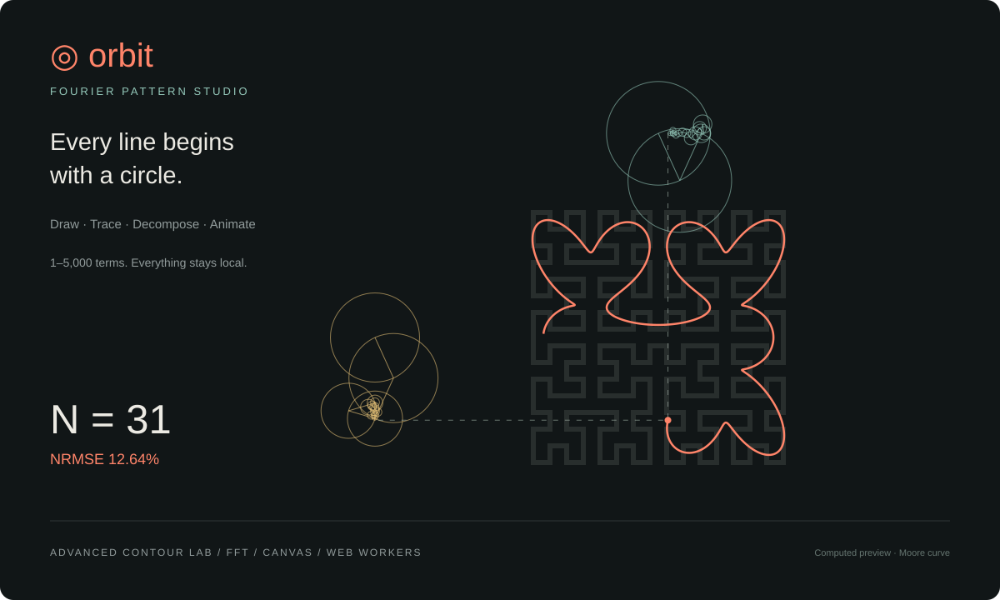

# Orbit — Fourier Pattern Studio

A browser-local creative coding playground that turns sketches and image contours into rotating Fourier epicycles.



**Web demo:** the complete static app is in [`dist/`](dist/). The repository is prepared for GitHub Pages; the public demo link will be added after the first successful deployment.

**Offline:** download [`orbit-studio.html`](dist/orbit-studio.html) and open it in a modern browser. No server or installation is required for the standalone version.

## Features

- **Draw your own path** with a mouse, touch screen or stylus; undo and clear strokes.
- **Upload an image** and inspect candidate contours before animating one.
- **Advanced contour lab:** automatic background polarity, Otsu and adaptive thresholds, alpha silhouettes, Canny-style photo edges, noise reduction and morphological cleanup.
- **Refine geometry:** remove tiny components, include or exclude interior contours, ignore image-frame outlines, simplify vertices and smooth the curve.
- **Choose visually:** click a contour in the preview, or use the ranked contour list. Toggle the binary mask to understand extraction.
- **1–5,000 Fourier terms**, with exact numeric input, 8,192 arc-length samples and a dependency-free radix-2 FFT.
- **Two animation modes:** independent X/Y chains or a single complex-plane chain.
- Playback, scrubbing, speed, colors, fullscreen, PNG snapshots, complete SVG paths and JSON project files.
- All image and sketch processing happens locally. There are no analytics, image-upload endpoints, API keys or runtime dependencies.

## Run locally

Use any static HTTP server from the repository root:

```sh
python3 -m http.server 8000 --directory dist
```

Open `http://localhost:8000`. Static hosting enables the dedicated contour Web Worker. The standalone HTML embeds its worker source and has a synchronous fallback when workers are unavailable.

## Image lab guide

| Mode | Best for | Behavior |
| --- | --- | --- |
| Auto | Logos and silhouettes | Uses alpha when meaningful transparency is present; otherwise Otsu and border-based foreground polarity. |
| Otsu | Clear foreground/background contrast | Finds a global intensity threshold automatically. |
| Adaptive | Uneven lighting | Compares each pixel with its neighborhood mean. Foreground can be dark or light. |
| Photo edges | Photographs and line detail | Gaussian-style blur, Sobel gradients, non-maximum suppression and hysteresis; traces the boundaries of the resulting edge regions. |
| Alpha | Transparent PNG or SVG | Extracts opaque silhouettes independent of their RGB color. |
| Manual | Difficult contrast | Uses an explicit threshold and polarity. |

Start with **Auto**. Try **Adaptive** when shadows affect the result, and **Photo edges** for internal details. Use the binary-mask preview before increasing Fourier terms: more terms cannot repair a poor source contour.

- **Denoise** applies repeated separable binomial blur passes.
- **Close small gaps** performs a 3×3 dilation followed by erosion; **Remove specks** uses the inverse order.
- **Minimum area** removes small connected foreground regions and filters small contour loops, including holes.
- **Simplify** uses closed-loop Ramer–Douglas–Peucker simplification.
- **Smoothing** uses Chaikin corner cutting. Higher values round sharp corners and change the source geometry.
- Up to **100 contours**, ranked by enclosed area, are available at **512, 768 or 1,024 px** processing resolution.
- A deterministic [sample image](dist/examples/contour-test.svg) includes a silhouette, a hole and small specks for experimentation.

## How the animation works

1. Resample a selected closed path at 8,192 uniformly spaced arc-length positions.
2. Normalize it to a centered coordinate system.
3. Compute normalized complex Fourier coefficients using a radix-2 FFT.
4. Keep exactly N signed-frequency terms, starting with DC and increasing absolute frequency.
5. Draw rotating vectors in descending amplitude order; their sum locates the tip.
6. Reconstruct the full sampled curve with the inverse FFT for export and error calculation.

In X/Y mode, each axis retains N terms independently. For even N, the final signed-frequency pair is incomplete; the real projection is used for each axis. Complex-plane reconstruction can therefore differ slightly from X/Y mode at even N. Both modes use their own reconstructed path for the displayed error.

The error is:

```text
NRMSE (%) = 100 × RMS(reconstruction − sampled_path)
                 / RMS(sampled_path − mean(sampled_path))
```

This measures reconstruction of the **processed selected path**, not segmentation quality against the original image or the error definition of any reference video.

## Tests and offline build

Node.js 20 or later is sufficient. No package installation is needed.

```sh
npm test
npm run build:offline
node scripts/preview.cjs
```

The tests cover FFT agreement with a direct DFT, exact 5,000-term selection, even/odd X/Y reconstruction, error convergence, alpha and polarity detection, holes, diagonal topology, noise removal, adaptive and edge extraction, simplification and smoothing. Browser/device interaction tests are not included in these algorithmic checks.

## Repository layout

```text
dist/                 Static web demo and standalone HTML
  app.js              UI, drawing, animation and file handling
  math.js             Arc-length sampling, FFT and reconstruction
  contours.js         Pure image-processing and contour engine
  contour-worker.js   Background extraction worker
  examples/           Small synthetic input fixture
tests/                Image-processing regression checks
verify.cjs            Fourier and UI-target regression checks
scripts/              Offline packaging and computed preview
assets/preview.svg    Illustration computed from the Fourier model
```

## GitHub Pages

The included `pages.yml` workflow tests the source, rebuilds the offline file and publishes `dist/`. In repository **Settings → Pages**, select **GitHub Actions** as the source. Once the workflow succeeds, use its deployment URL as the README demo link and repository website.

GitHub Pages normally includes the GitHub account or organization handle in its URL. Use a custom domain if an account-free URL is required. This repository intentionally excludes the private hosting manifest, account-specific deployment links, credentials and user-uploaded images.

## Limitations

- This is geometric image processing, not semantic object segmentation. It cannot reliably infer the intended object in every photograph.
- Photo-edge mode traces regions around edges; it can produce inner/outer double outlines rather than a single centerline.
- One closed contour is animated at a time. Separate hand-drawn strokes and open endpoints are connected in drawing order.
- Area filtering and smoothing can remove small details. Reducing simplification and smoothing preserves more corners.
- High term counts and large images may render more slowly on mobile devices; subpixel circles are skipped visually while their vectors still contribute to the sum.
- PNG saves the current animation canvas. SVG saves the complete reconstructed path on a transparent background. Video/GIF export is not implemented.
- JSON projects preserve the active sampled path, drawing strokes and animation settings. They do not retain the original image or image-lab extraction settings.

## Privacy

Images are decoded and processed in the browser. The app does not transmit their contents. Files are saved only when you request an export. Hosting providers still receive ordinary page requests. A public GitHub repository exposes its owner handle even when the source contains no personal information.
